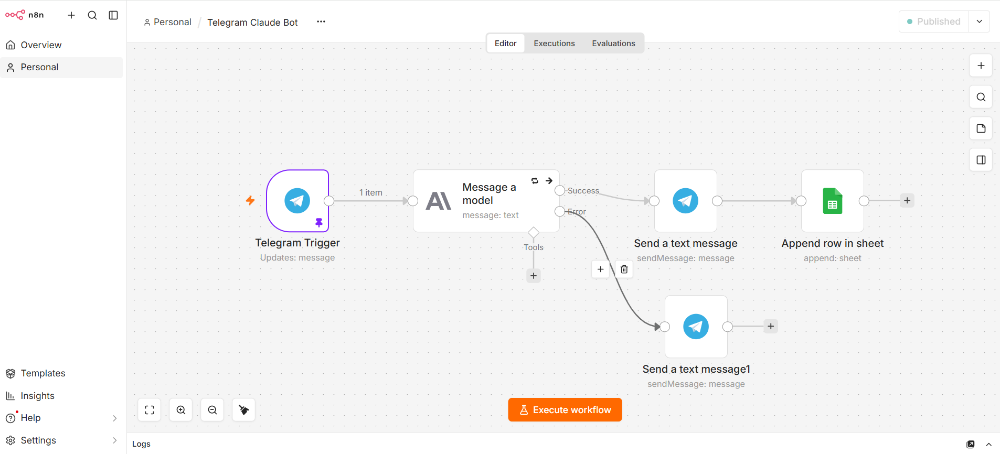

# n8n Telegram + Claude Bot

A Telegram chatbot built in n8n. Messages sent to the bot are answered by Claude, with a system prompt that keeps replies short and plain-text.

## How it works

1. **Telegram Trigger** receives each incoming message through a webhook.
2. **Message a model** (Anthropic Claude) sends the text to Claude with a system prompt.
3. **Send a text message** returns Claude's reply to the same Telegram chat.
4. Logs every conversation (time, chat ID, user, question, answer) to Google Sheets
5. If the Claude API fails, an error branch sends the user a friendly fallback message

## Stack

- n8n, self-hosted with Docker
- Anthropic Claude API
- Telegram Bot API
- ngrok, to expose the local n8n webhook over HTTPS

## Setup

1. Run n8n in Docker and expose it over HTTPS (for example with ngrok). Set the `WEBHOOK_URL` environment variable to your public address.
2. In n8n, import `workflow.json`.
3. Create two credentials in n8n: a Telegram bot token (from @BotFather) and an Anthropic API key. Credentials are not included in this repo.
4. Assign the credentials to the nodes and publish the workflow.
5. Message your bot.

## Notes

- A Telegram bot can only have one active webhook, so test runs and a published workflow cannot listen at the same time.
- Planned next: deployment to a VPS with a fixed domain, so ngrok is no longer needed.
